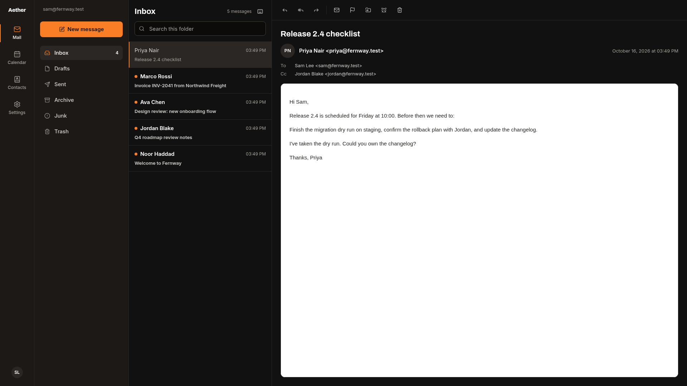
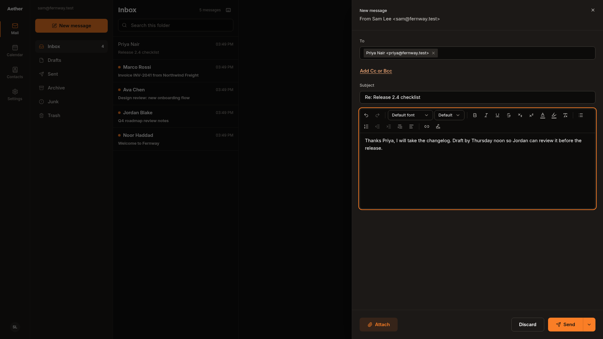
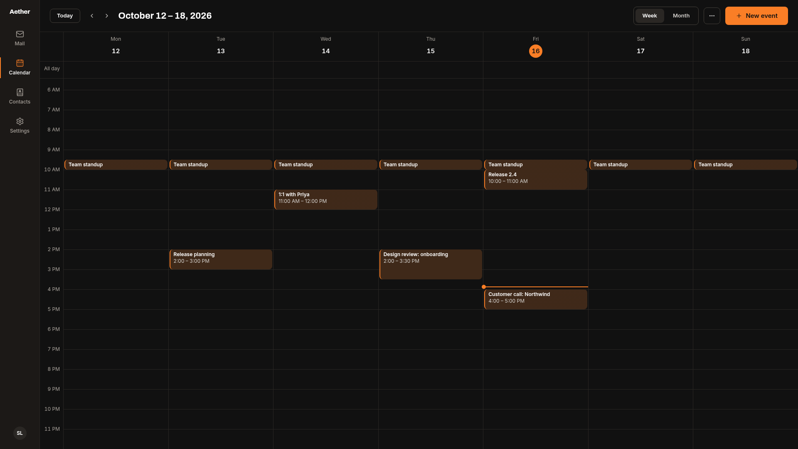
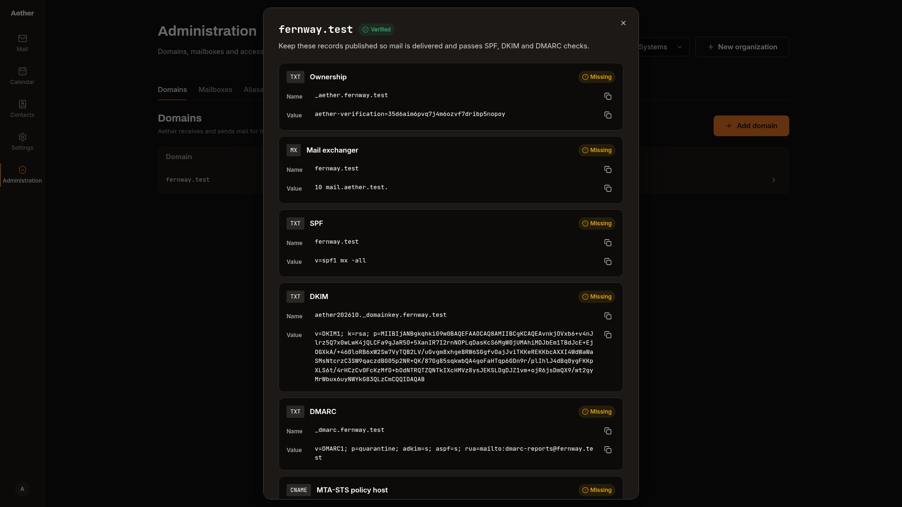
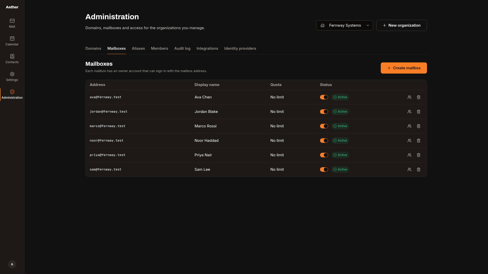

<h1></h1>

[](CHANGELOG.md)
[](LICENSE)
[](#requirements)

**Aether is an open-source email platform that you host yourself.** It runs your mail server, webmail, calendar and contacts from one Docker Compose file, and people sign in with a local account, [Halo](https://github.com/ScalaStudios/Halo) or any OpenID Connect provider.

In mail server terms, Aether is Postfix for SMTP, Dovecot for IMAP and Rspamd for spam filtering and DKIM, configured from PostgreSQL by a Go control plane, so nobody edits map files by hand. On top of that stack it adds a web admin console for domains, mailboxes and aliases, Aether Mail for reading and sending in the browser, and CalDAV and CardDAV for calendar and contacts apps.

<p>
  <a href="#quick-start"></a>
  <a href="#set-up-your-first-domain"></a>
  <a href="#architecture"></a>
  <a href="#documentation"></a>
  <a href="SECURITY.md"></a>
</p>

> [!NOTE]
> Aether is pre-1.0 and runs Scala Studios' own mail at scala.gg. The current release is 0.1.0, and [CHANGELOG.md](CHANGELOG.md) lists what is in it. The API and configuration may change before 1.0. [Known limitations](#known-limitations) lists what is not built.



## Why Aether

Aether works in the same space as hosted services such as Google Workspace, Microsoft 365 and Fastmail, and open-source mail servers such as Mailcow, Mailu, docker-mailserver and Stalwart. It is built around a few choices:

- **A mail stack with a long track record.** Postfix, Dovecot and Rspamd have each run in production for 10 to 20 years, and every mail client interoperates with them. Aether configures them; it does not replace them.
- **One control plane owns every setting.** The Go API is the only component that writes data. Postfix and Dovecot read domains, mailboxes and aliases from PostgreSQL views through a role that cannot see password hashes or keys.
- **Its own webmail, calendar and contacts.** Aether Mail is part of the project rather than a bundled third-party client, so it shares accounts, permissions and the API with everything else.
- **Single sign-on in the core.** OpenID Connect sign-in, group-to-role mapping, accounts created on first sign-in, and suspension through signed Halo webhooks are built in, not added through a proxy.
- **Small to run.** Everything runs on one Docker host from one Compose file, with no license key, no telemetry and no paid tier.

## Features

| Area | What Aether includes |
| --- | --- |
| **Mail server** | Inbound SMTP on port 25, submission on 465 and 587, and IMAP on 143 and 993. Domains, mailboxes, aliases, catch-all addresses, distribution lists and quotas, all stored in PostgreSQL. A mailbox can only send as itself and as aliases that point to it, checked on both the envelope and the From header. |
| **Filtering and signing** | Rspamd spam scoring with DNS blocklists queried through a bundled Unbound resolver, spam filed into Junk, DKIM signing with a 2048-bit RSA key per domain, ARC signing, outbound rate limits and optional ClamAV virus scanning. |
| **Deliverability** | DNS records generated for every domain with a live check, MTA-STS policies and TLS reporting, DMARC aggregate reports received and summarized per sending IP, SRS for aliases that forward outside, and DANE checks on outbound mail. |
| **Mail app setup** | Thunderbird autoconfig, Autodiscover XML and RFC 6186 SRV records for every domain, and an Apple configuration profile with mail, calendar and contacts. |
| **Webmail** | Aether Mail: folders, conversations, server-side search, rich-text compose with signatures and inline images, attachments, drafts, scheduled send, snooze, keyboard shortcuts, and HTML mail rendered with remote content blocked. |
| **Importing** | Copy every folder from Gmail, iCloud, Yahoo, Fastmail or any other IMAP account into a mailbox, in the background, keeping flags and dates and skipping messages that are already there. |
| **Rules and sharing** | Mail rules and automatic replies compiled to Sieve, so they run on the server for every client. Shared mailboxes with full or read-only access for members of the organization. |
| **Calendar and contacts** | CalDAV and CardDAV at `/dav/`, calendars with repeating events and ICS import and export, meeting invitations that work with Gmail, Outlook and Apple Calendar, shared and organization calendars, free/busy while you schedule, a personal address book and the organization directory. |
| **Sign-in** | Local accounts with Argon2id password hashes, or any OpenID Connect provider with PKCE. Halo gets a setup wizard, group-to-role mapping, suspension webhooks and SCIM provisioning. Profile pictures are uploaded or imported from the identity provider. Mail and calendar apps use app passwords scoped to one mailbox, or an OIDC access token. |
| **Administration** | An admin console with organizations, domains and their DNS status, mailboxes, aliases, members, identity providers, DMARC reports, API keys, signed webhooks and an audit log. |
| **Operations** | Health checks, Prometheus metrics for the API, Postfix, Dovecot and Rspamd with a Grafana dashboard, OpenTelemetry tracing, and backup and restore scripts with encrypted off-site copies through restic. |
| **Developers** | A REST API described by an OpenAPI 3.1 document, organization API keys with scopes, and signed webhooks for every audit event. |

Not built yet: Exchange ActiveSync. See [Known limitations](#known-limitations).

## Supported protocols

| Protocol | Status | How Aether uses it |
| --- | --- | --- |
| SMTP (RFC 5321) | Implemented | Postfix accepts mail on port 25 for verified domains, and submission on 587 with STARTTLS and 465 with implicit TLS. Authentication is required before relaying |
| IMAP4rev1 (RFC 3501) | Implemented | Dovecot on 143 with STARTTLS and 993 with implicit TLS, with special-use folders, quotas and `THREAD=REFERENCES` |
| DKIM (RFC 6376) and ARC (RFC 8617) | Implemented | Rspamd signs outgoing mail with a key per domain that Aether generates, and verifies incoming signatures |
| SPF (RFC 7208) and DMARC (RFC 7489) | Implemented | Checked on incoming mail by Rspamd. Aether suggests the records to publish and summarizes the aggregate reports it receives |
| MTA-STS (RFC 8461) and TLS-RPT (RFC 8460) | Implemented | A policy served for every verified domain, starting in `testing` mode |
| DANE (RFC 7672) | Implemented for outbound mail | Postfix checks TLSA records through a DNSSEC-validating resolver. Aether does not publish TLSA records for its own domains |
| SRS | Implemented | Mail forwarded by an alias to an outside address gets a rewritten envelope sender, so it passes SPF |
| Sieve (RFC 5228) and ManageSieve (RFC 5804) | Implemented | Spam filing, mail rules, forwarding and automatic replies |
| CalDAV (RFC 4791) and CardDAV (RFC 6352) | Implemented | Built into the Go API at `/dav/`, with discovery at `/.well-known` |
| SCIM 2.0 (RFC 7643 and RFC 7644) | Partial | A server for users under `/api/v1/scim/<provider>`, so Halo can create, update and deactivate accounts. No groups, bulk operations or filters other than `userName eq` |
| OpenID Connect and PKCE (RFC 7636) | Implemented | Web sign-in with the authorization code flow, `S256`, nonce checking and state bound to the browser |
| Exchange ActiveSync, EWS and MAPI | Not implemented | Outlook connects as an IMAP account instead |
| OAUTHBEARER (RFC 7628) and XOAUTH2 | Implemented | IMAP and SMTP submission accept OpenID Connect access tokens, checked through the provider's token introspection endpoint |

"Implemented" means the feature works on the current `main` branch and is covered by the integration tests. Aether has not been through an independent security audit.

## How it works



- **Postfix** accepts a message on port 25 only for a domain that Aether has verified, and only for an address that exists as a mailbox or an alias. It looks both up in PostgreSQL.
- **Rspamd** runs as a milter while the SMTP session is still open. It checks SPF, DKIM and DMARC, queries DNS blocklists and scores the message, so mail that should be rejected is refused before Postfix accepts it.
- **Dovecot** receives the message from Postfix over LMTP and stores it in the mailbox as Maildir. A global Sieve script files spam into Junk.
- **Sieve** then runs the mailbox's own rules and automatic replies, which the API compiles from what people set in Aether Mail. Forwarded mail and automatic replies go back out through Postfix.
- **Clients** see the message straight away: Aether Mail reads the mailbox over IMAP through the API, and phones and desktop apps connect to Dovecot directly.

Outgoing mail runs the other way. Aether Mail and mail apps submit to Postfix with authentication, Rspamd checks the sender and signs the message with the domain's DKIM key, and Postfix delivers it, over TLS where the receiving server offers it.

## Quick start

### Requirements

To try Aether on your own computer, you need Docker with Compose v2. Nothing is sent to the internet.

To receive and send real mail, you also need:

- A Linux server with Docker Engine 24 or later, 2 vCPUs and 4 GB of memory, plus about 1.5 GB more if you turn on ClamAV, and disk space for mail.
- A static public IPv4 address with a clean reputation. Many cloud and home address ranges are on blocklists, and other mail servers refuse or junk mail from them.
- A reverse DNS (PTR) record for that address that matches the mail hostname, set at your hosting provider.
- Inbound TCP 25, 465, 587, 143, 993, 80 and 443, and outbound TCP 25. If your provider blocks outbound 25, send through an [authenticated relay](documentation/installation.md#outbound-relay).
- Access to the DNS of every domain you want to receive mail for.

### Run it locally

```bash
git clone https://github.com/ScalaStudios/Aether.git && cd Aether
./scripts/setup.sh dev
docker compose up -d --build
echo 'choose-a-long-password' | docker compose exec -T api aether bootstrap-admin --email admin@aether.test --password-stdin
```

Open http://localhost:8080 and sign in as `admin@aether.test`. In **Administration**, create an organization, add the domain `aether.test` and create a mailbox with a password. A domain added by a platform administrator is verified straight away. Sign out and sign in as the mailbox to use Aether Mail.

The development stack uses a self-signed certificate for `mail.aether.test` and these ports:

| Service | Host port |
| --- | --- |
| Web | 8080 |
| SMTP | 2525 |
| Submission | 5870 (STARTTLS), 4650 (TLS) |
| IMAP | 1430 (STARTTLS), 9930 (TLS) |

### Install on a server

Point an `A` record such as `mail.example.com` at the server and set its PTR record to the same name. Then:

```bash
git clone --branch v0.1.0 https://github.com/ScalaStudios/Aether.git && cd Aether
./scripts/setup.sh
```

`setup.sh` writes `.env` with random secrets. Set the three addresses in it:

```bash
AETHER_PUBLIC_URL=https://mail.example.com
AETHER_SITE_ADDRESS=mail.example.com
AETHER_MAIL_HOSTNAME=mail.example.com
```

Install a trusted certificate for the mail hostname in the `tls` volume, then start the stack and create the first administrator:

```bash
docker compose up -d --build
docker compose exec api aether bootstrap-admin --email you@example.com
```

The command prints a generated password once. Caddy obtains the web certificate on its own. The [installation guide](documentation/installation.md) covers the certificate, running behind an existing reverse proxy, outbound relays and monitoring.

## Set up your first domain

1. In **Administration**, create an organization and choose **Add domain**.
2. Open the domain. Aether lists every DNS record to publish and checks each one live.
3. Publish the records at your DNS provider and choose **Verify**. Aether accepts mail for a domain only after it is verified.
4. Create mailboxes under **Mailboxes**, and aliases under **Aliases**.

For `example.com` with the mail host `mail.example.com`, the records are:

| Type | Name | Value | Needed |
| --- | --- | --- | --- |
| TXT | `_aether.example.com` | `aether-verification=<token>` | Yes: proves you own the domain |
| MX | `example.com` | `10 mail.example.com.` | Yes: routes incoming mail to Aether |
| TXT | `example.com` | `v=spf1 mx -all` | Yes: SPF. Add your relay here if you use one |
| TXT | `<selector>._domainkey.example.com` | `v=DKIM1; k=rsa; p=…` | Yes: the domain's DKIM public key |
| TXT | `_dmarc.example.com` | `v=DMARC1; p=quarantine; adkim=s; aspf=s; rua=mailto:dmarc-reports@example.com` | Yes: DMARC, with reports sent back to Aether |
| CNAME | `mta-sts.example.com` | `mail.example.com.` | Recommended: serves the MTA-STS policy |
| TXT | `_mta-sts.example.com` | `v=STSv1; id=<id>` | Recommended: announces the MTA-STS policy |
| TXT | `_smtp._tls.example.com` | `v=TLSRPTv1; rua=mailto:postmaster@example.com` | Recommended: asks for TLS reports |
| CNAME | `autoconfig.example.com` | `mail.example.com.` | Recommended: Thunderbird finds the settings |
| CNAME | `autodiscover.example.com` | `mail.example.com.` | Recommended: Autodiscover clients find the settings |
| SRV | `_imaps._tcp.example.com` | `0 1 993 mail.example.com.` | Recommended: IMAP service lookup |
| SRV | `_submissions._tcp.example.com` | `0 1 465 mail.example.com.` | Recommended: SMTP submission lookup |

To connect a mail or calendar app, create an app password in **Settings → App passwords**. Each one works for one mailbox and is shown once. With the recommended records in place, Thunderbird fills in the servers from the address alone, and **Set up an Apple device** downloads a profile that adds mail, calendar and contacts to an iPhone, iPad or Mac in one step.

| Setting | Value |
| --- | --- |
| IMAP | `mail.example.com`, port 993 (SSL/TLS) or 143 (STARTTLS) |
| SMTP | `mail.example.com`, port 465 (SSL/TLS) or 587 (STARTTLS) |
| CalDAV and CardDAV | `https://mail.example.com/dav/`, or just the host name for apps that support discovery |
| Username | The full mailbox address |
| Password | The app password |

iOS Mail, Calendar and Contacts have been tested against a production installation. Thunderbird, Apple Mail on macOS, Outlook as an IMAP account, Android mail apps and DAVx5 use the same standards and are expected to work, but have not been tested yet.

To let people sign in with Halo, open **Administration → Identity providers → Connect Halo**, enter Halo's issuer, client ID and client secret, and register `https://mail.example.com/api/v1/auth/oidc/<slug>/callback` as the redirect URI in Halo. Any other OpenID Connect provider works through **Add OIDC provider**. [Authentication](documentation/authentication.md) covers scopes, group mapping and webhooks.

## Screenshots

<table>
  <tr>
    <td width="50%"><br>Rich-text compose with signatures</td>
    <td width="50%"><br>Calendar, also available over CalDAV</td>
  </tr>
  <tr>
    <td width="50%"><br>DNS records and a live check for every domain</td>
    <td width="50%"><br>Mailboxes, aliases and members per organization</td>
  </tr>
</table>

## Architecture



The Go API is the only component that writes application data. It keeps organizations, domains, mailboxes, aliases, users, calendars, contacts and the audit log in PostgreSQL, and encrypts DKIM private keys and OIDC client secrets with AES-256-GCM under `AETHER_SECRET_KEY`. Postfix and Dovecot read a small set of PostgreSQL views through a role that can only `SELECT` from them. Aether Mail reads mailboxes over IMAP and sends over SMTP submission through the API, which logs in to Dovecot with a master user and opens a mailbox only for someone allowed to use it. Rspamd keeps its statistics, rate limits and the published DKIM keys in Valkey.

| Component | Path | What it is |
| --- | --- | --- |
| API and CLI | `cmd/aether/`, `internal/` | The Go server: REST API, CalDAV and CardDAV, OIDC, webmail bridge, DMARC report intake, and the `serve`, `migrate` and `bootstrap-admin` commands |
| Web app | `apps/web/` | Aether Mail, Calendar, Contacts, Settings and Administration, built with Next.js |
| Database schema | `migrations/` | Numbered PostgreSQL migrations, embedded in the binary and run when the API starts |
| Mail stack | `infrastructure/docker/` | Images and configuration for Postfix, Dovecot, Rspamd, Unbound, Caddy and PostgreSQL |
| Helm chart | `infrastructure/helm/` | A chart that validates in CI but has not run on a real cluster |
| API contract | `api/openapi.yaml` | The OpenAPI 3.1 description of every route |
| Scripts | `scripts/` | Setup, backup, restore and TLS certificate sync |
| Tests | `tests/integration/` | End-to-end tests against the running stack |

[Architecture and decisions](documentation/architecture.md) explains the trust boundaries, and why Aether is built on Postfix, Dovecot and Rspamd rather than an all-in-one mail server.

## Configuration

`./scripts/setup.sh` writes `.env` from `.env.example` and fills in every password and key. These are the values most installations change:

| Variable | Default | What it sets |
| --- | --- | --- |
| `AETHER_PUBLIC_URL` | none | The address people open in a browser, such as `https://mail.example.com` |
| `AETHER_SITE_ADDRESS` | none | The host Caddy serves and obtains a certificate for |
| `AETHER_MAIL_HOSTNAME` | none | The SMTP and IMAP host name, which the PTR record and the MX records point at |
| `AETHER_SECRET_KEY` | generated | Encrypts DKIM keys and OIDC client secrets. A backup cannot be used without it |
| `AETHER_LOCAL_LOGIN` | `true` | Password sign-in. Set it to `false` once an identity provider is connected |
| `AETHER_RELAYHOST`, `AETHER_RELAY_USER`, `AETHER_RELAY_PASSWORD` | none | An authenticated relay for outgoing mail, for hosts that block outbound port 25 |
| `AETHER_MTA_STS_MODE` | `testing` | The MTA-STS policy mode. Set it to `enforce` once TLS reports show no failures |
| `AETHER_BACKUP_REPOSITORY`, `AETHER_BACKUP_PASSWORD` | none | A restic repository on S3-compatible storage for off-site backups, and its encryption password |
| `COMPOSE_PROFILES` | none | `antivirus` for ClamAV and `monitoring` for Prometheus and Grafana |
| `COMPOSE_FILE` | `compose.yml` | Add `compose.external-proxy.yml` to run behind an existing reverse proxy instead of Caddy |

## Running in production

- **One host.** Every service runs on one machine. That keeps Aether simple to run, but it is not highly available: while the host is down, webmail and IMAP are unavailable. Other mail servers queue mail for your domains and retry for several days, so a short outage does not usually lose incoming mail.
- **Back up four things.** The `pgdata` volume with `pg_dump`, the `vmail` volume with the mail, `.env` with `AETHER_SECRET_KEY`, and the mail certificate in the `tls` volume. `scripts/backup.sh` writes the first three to a dated directory, checks they can be read, and copies them to S3-compatible storage when a restic repository is set. `scripts/restore.sh` puts them back. The `rspamd` and `valkeydata` volumes rebuild themselves.
- **Expect to work on deliverability.** Correct SPF, DKIM, DMARC and reverse DNS are necessary but do not guarantee the inbox. Gmail and Outlook also judge the sending address's history and volume. Start with a clean address and low volume, and read the DMARC report summaries before tightening the policy to `p=reject`.
- **Use a trusted mail certificate.** Without one, the stack generates a self-signed certificate, mail apps warn about it, and MTA-STS cannot move to `enforce`. Behind your own reverse proxy, `scripts/sync-tls-cert.sh` copies its certificate to Postfix and Dovecot.
- **Keep metrics private.** The metrics ports are only reachable inside the Compose network, and Grafana listens on `127.0.0.1:3300`. Reach it through an SSH tunnel or your VPN.
- **Upgrade** by checking out the new release, such as `git fetch --tags && git checkout v0.2.0`, then `docker compose up -d --build`. Read its section in [CHANGELOG.md](CHANGELOG.md) first. Database migrations run when the API starts, inside a transaction and behind an advisory lock.

## Known limitations

- Everything runs on one host. There is no clustering, and the Helm chart has not run on a real cluster.
- Exchange ActiveSync, EWS and MAPI are not implemented, so Outlook cannot connect as an Exchange or Microsoft 365 account.
- Aether does not publish TLSA records for its own mail host. They need DNSSEC on the domain and a mail key that stays the same across certificate renewals.
- Only iOS Mail, Calendar and Contacts have been tested against a production installation.

## Documentation

- [Installation](documentation/installation.md): requirements, a production install, running behind a reverse proxy, outbound relays, MTA-STS, DANE, monitoring, antivirus, upgrades, and backups with restore.
- [Authentication](documentation/authentication.md): local accounts, Halo, other OpenID Connect providers, app passwords, and setting up mail, calendar and contacts apps.
- [Architecture](documentation/architecture.md): the components, the trust boundaries, and how rules, forwarding and automatic replies work.
- [API keys and webhooks](documentation/integrations.md): automate Aether and react to its audit events.
- [Kubernetes](documentation/kubernetes.md): the state of the Helm chart.
- [Third-party components](documentation/third-party.md): every bundled component and its license.
- [API specification](api/openapi.yaml): the OpenAPI 3.1 document.

## Contributing

Bug reports, fixes, documentation and features are welcome. Report bugs and propose features in [GitHub issues](https://github.com/ScalaStudios/Aether/issues), and open an issue before starting anything large, such as a new feature, a new dependency or a schema change. [CONTRIBUTING.md](CONTRIBUTING.md) covers the development setup, the checks a pull request must pass and the code style. Everyone taking part follows the [Code of Conduct](CODE_OF_CONDUCT.md). The integration tests run against the real Postfix, Dovecot, Rspamd and PostgreSQL containers:

```bash
AETHER_TEST_ADMIN_EMAIL=admin@aether.test AETHER_TEST_ADMIN_PASSWORD=choose-a-long-password \
  docker compose --profile test run --rm --no-deps integration-tests
```

## Security

Report vulnerabilities privately through [GitHub's private vulnerability reporting](https://github.com/ScalaStudios/Aether/security/advisories/new), never in a public issue. [SECURITY.md](SECURITY.md) lists what to include and what is in scope.

Postfix trusts only loopback, so a client without authentication can deliver only to Aether's own verified domains, and the integration tests check that relaying and spoofing are refused. Submission requires TLS before authentication, and Rspamd limits each sender to a bucket of 100 messages that drains at 200 an hour. Passwords are hashed with Argon2id, and sessions and app passwords are stored only as SHA-256 hashes. Every state-changing request needs a CSRF token bound to the session, and every API lookup checks the caller's organization. Aether Mail sanitizes HTML and blocks remote content. [Architecture](documentation/architecture.md#trust-boundaries) describes each trust boundary.

## License

Aether is licensed under the [GNU Affero General Public License v3.0 or later](LICENSE). Postfix, Dovecot, Rspamd, Valkey and PostgreSQL run as separate processes under their own licenses; [third-party components](documentation/third-party.md) lists them.

Aether is a Scala Studios project.
